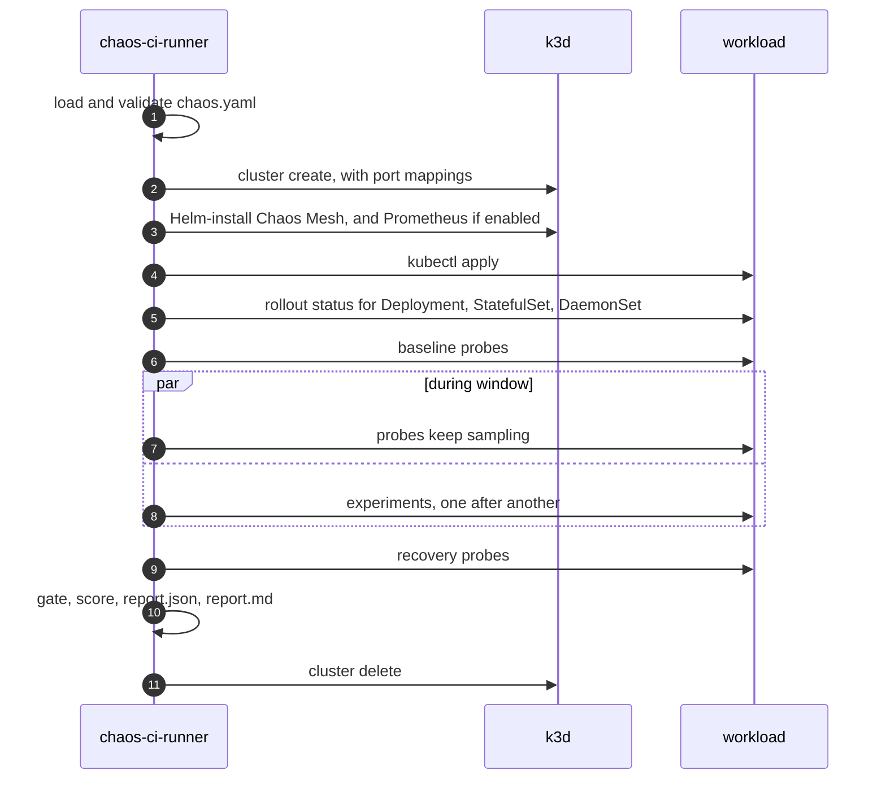

# chaos-ci-runner

`chaos-ci-runner` runs a chaos experiment against a workload in an
ephemeral k3d cluster, then fails the job if the workload does not meet
the contract in `chaos.yaml`. There is no shared cluster, no operator to
pre-install, and no scoreboard service. The report is a JSON artifact
and a Markdown comment.

It is for pull-request and mainline CI. It is not a production chaos
product. Production chaos needs the real cluster, the real change
process, and the real paging path. Those stay with Chaos Mesh, Litmus,
or whatever already runs there. This tool borrows their experiment
types and throws the cluster away when the job ends.

The package is Python 3.11+ (`typer`, pydantic v2). The cluster path
needs Linux, Docker, kubectl, Helm, and k3d. The unit-test path does
not.

## What a run decides

A run has three separate decisions. They are easy to mix up, and they
are not the same check.

| Decision | Question | Default | Fails when |
|---|---|---|---|
| Gate | Did this run meet its own contract? | on | Exit code 1. See [Gate](#gate). |
| Steady-state return | Did recovery come back to the baseline measured in this same run? | on (`gate.require_steady_state_return`) | Success rate drops by more than 10 points, or HTTP p99 is at least 100ms and 50% slower. |
| Regression | Did the 0–100 score fall versus the last green artifact? | on in the reusable workflow, using `gate.tier` | Score drop is greater than `gate.max_score_drop`. |

The score is not the gate. A run can pass its SLOs and still regress
against last green, or the reverse. The report prints both.

`steady_state.hypothesis` is copied into the report. It is not parsed
and it is not a pass/fail expression. The probes are the hypothesis
the gate can check.

## Install

From a checkout, for local commands that do not need a cluster:

```bash
python -m venv .venv
source .venv/bin/activate          # Windows: .venv\Scripts\activate
pip install -e ".[dev]"
```

CI installs the package with uv from this repository. See
[CI in this repository](#ci-in-this-repository) and
[Adopting it](#adopting-it).

`chaos-ci-runner doctor` checks the cluster tools. It runs
`docker version`, `docker info` (the daemon must answer),
`kubectl version --client`, `helm version`, and `k3d version`.
Exit 0 means all five answered. Exit 2 means one is missing or the
daemon is down.

## Command line

```text
chaos-ci-runner version
chaos-ci-runner doctor
chaos-ci-runner validate --config chaos.yaml
chaos-ci-runner schema
chaos-ci-runner plan    --config chaos.yaml
chaos-ci-runner run     --config chaos.yaml --report-dir reports/
chaos-ci-runner regression --current reports/report.json \
                           --baseline baseline/report.json \
                           --config chaos.yaml
```

| Command | Cluster? | What it does |
|---|---|---|
| `version` | no | Prints `0.7.0`. |
| `doctor` | no | Preflight for Docker, kubectl, Helm, and k3d. |
| `validate` | no | Loads `chaos.yaml`. If the target manifest exists, fails when a namespaced object declares a different namespace. |
| `schema` | no | Prints the JSON Schema for `chaos.yaml`. |
| `plan` | no | Prints the experiment manifests that `run` would apply. |
| `run` | yes | Full pipeline. `--keep-cluster` leaves the k3d cluster up. `--cluster-name` overrides the generated name. |
| `regression` | no | Compares two `report.json` files. `--max-drop` overrides the tolerance. With `--config`, the tolerance comes from `gate.max_score_drop` / `gate.tier`. A missing baseline file is exit 0 (first run). A missing score in the current report is exit 2. |

Exit codes, for `run` and `regression`:

| Code | Meaning |
|---:|---|
| 0 | Gate passed, or the score drop is within tolerance, or there is no baseline yet. |
| 1 | Gate failed, or the score dropped further than allowed. |
| 2 | Invalid config, missing tool, or any other infrastructure error. |

On a gate failure, and on an infrastructure error after the cluster
exists, `run` writes `reports/diagnostics/` (`kubectl get`, controller
logs, Chaos Mesh and Litmus objects). The cluster is deleted afterwards
unless `--keep-cluster` is set. `down` is best-effort: a failed delete
does not hide the original error.

## Adopting it

Two files in the service repository.

`chaos.yaml` (the tested sample is
[`examples/nginx/chaos.yaml`](examples/nginx/chaos.yaml); copy that and
edit the manifest path, selectors, and thresholds):

```yaml
cluster:
  port_mappings: ["30080:30080@server:0"]

observability:
  prometheus: true

target:
  manifest: ./k8s/app.yaml
  namespace: default
  ready_timeout_s: 120

steady_state:
  hypothesis: The service stays reachable and the ready-pod count holds.
  http_probes:
    - name: api
      url: http://localhost:30080/healthz
      success_rate_pct: 99
      latency_p99_ms: 200
  prometheus_probes:
    - name: pods-ready
      query: 'sum(kube_pod_status_ready{namespace="default", condition="true"})'
      min: 2

experiments:
  - name: pod-kill
    engine: chaos-mesh
    kind: PodChaos
    duration_s: 20
    spec:
      action: pod-kill
      mode: one
      selector:
        labelSelectors:
          app: my-app
  - name: net-delay
    engine: chaos-mesh
    kind: NetworkChaos
    duration_s: 30
    spec:
      action: delay
      mode: all
      selector:
        labelSelectors:
          app: my-app
      delay:
        latency: "200ms"

gate:
  tier: standard
  min_pass_rate_pct: 100
  fail_on_probe_breach: true
  require_steady_state_return: true
  halt_when_steady_state_lost: false
```

`.github/workflows/chaos.yml`:

```yaml
name: chaos
on: [pull_request]
jobs:
  chaos:
    uses: sanjeev0120test/chaos-ci-runner/.github/workflows/chaos-reusable.yml@main
    with:
      config: ./chaos.yaml
```

Optional inputs on that reusable workflow:

| Input | Default | Meaning |
|---|---|---|
| `config` | required | Path to `chaos.yaml` in the caller repository. |
| `chaos_ci_runner_ref` | `main` | Git ref installed with `uv pip`. |
| `report_dir` | `reports` | Where `report.json` and `report.md` are written. |
| `runner_os` | `ubuntu-latest` | GitHub-hosted runner. |
| `comment_on_pr` | `true` | Upsert one pull-request comment. |

The job checks out the caller, installs this package and the pinned
CLIs, runs `doctor`, runs `run`, downloads the last green `chaos-report`
artifact from the default branch when one exists, runs `regression`,
uploads `reports/` as `chaos-report`, and upserts a comment marked
`<!-- chaos-ci-runner-report -->`. The job timeout is 20 minutes.
Permissions needed: `contents: read`, `actions: read`,
`pull-requests: write`.

Field-by-field schema:
[docs/chaos-yaml-reference.md](docs/chaos-yaml-reference.md).
`chaos-ci-runner schema` prints the same model as JSON Schema.
Unknown keys are rejected (`extra: forbid`).

Names that become Kubernetes labels or object names must be DNS-1123
labels: lowercase letters, digits, and hyphens, at most 63 characters,
starting and ending with a letter or digit. That applies to
`target.namespace`, every experiment name, and every probe name.
Experiment names must be unique. Probe names must be unique across HTTP
and Prometheus probes. Port mappings must match k3d's `--port` form
(`30080:30080@server:0` is the one the nginx sample uses).

## How a run proceeds



1. Load `chaos.yaml`. This fails before a cluster exists when the
   schema, names, port mappings, or duplicate names are wrong.
2. `k3d cluster create`. The k3s image defaults to
   `rancher/k3s:v1.30.4-k3s1`. NodePort mappings are how probes on the
   runner reach the workload.
3. Install the engines the experiments ask for. Chaos Mesh is Helm
   chart `2.7.0` from `https://charts.chaos-mesh.org`, into namespace
   `chaos-mesh`, with `--create-namespace`. Litmus, if any experiment
   uses it, gets a namespace and RBAC only. It does not install
   `litmus-operator`. That engine is experimental: experiments run as
   Jobs using `litmuschaos/go-runner:3.10.0`.
4. If `observability.prometheus` is true, Helm-install
   `prometheus-community/prometheus` chart `27.5.1` into `monitoring`.
   Alertmanager, node-exporter, Pushgateway, and the server persistent
   volume are off. kube-state-metrics stays on. Prometheus is exposed
   on NodePort `30090` unless `prometheus_node_port` changes it.
   Prometheus probes without this flag are a config error.
5. Apply the target manifest. Relative paths are resolved next to
   `chaos.yaml`, then from the working directory. Wait for rollout of
   every Deployment, StatefulSet, and DaemonSet in `target.namespace`.
   A namespace with none of those returns immediately. The timeout is
   `target.ready_timeout_s` (default 60).
6. Baseline probes, for `duration_s` each. HTTP and PromQL.
7. Start during-window probes on background threads, then run
   experiments in order. With `gate.halt_when_steady_state_lost: true`,
   an experiment that has not started is recorded as `skipped` once a
   during-window probe has at least one sample and has breached its
   SLO. An empty during window does not halt. The nginx sample leaves
   this off, so both of its experiments run. Skipped experiments do
   not count as successes.
8. Stop the during-window probes. The gate scores a snapshot taken at
   stop, so a request still in flight cannot change the window.
9. Recovery probes, same specs, window name `recovery`.
10. Evaluate the gate, compute the score, write `report.json` and
    `report.md`. Markdown posted to GitHub is capped at 64 KiB. Table
    cells escape `|`. Probe logs drop URL userinfo and query strings.
11. If `GITHUB_STEP_SUMMARY` is set, append the Markdown there.
12. Delete the cluster.

Chaos Mesh watch, per experiment: `Stop`, `AllRecovered`, a pause
after injection, or holding for `duration_s` after injection is
success. A pause before injection is failure. No injection within 60
seconds is failure. The CRD is deleted when the watch finishes, including
when the watch raises.

## Probes

Each HTTP probe and each PromQL probe runs three windows: `baseline`,
`during`, and `recovery`.

HTTP success is a response status in `[200, 400)`. HTTP p99 is the
nearest-rank index `round(0.99 * (n - 1))` over **successful** samples
only. A timeout or a 5xx is an availability miss. It lowers the success
rate and it is not a latency sample. If every sample failed, p99 is 0
and the success rate is 0%. A window with zero samples is a breach and
scores as 0%.

PromQL uses an instant query. The result must be a scalar or a vector
of exactly one series. Anything else is a failed sample. A sample passes
when the value is within `min` and `max` (at least one bound is
required).

Baseline and recovery windows stop when `duration_s` ends. They do not
sleep another full interval past that deadline.

## Gate

`gate.evaluate` fails the run (exit 1) when any of these hold:

1. Experiment success rate is below `gate.min_pass_rate_pct`
   (default 100). Status `succeeded` counts. `skipped` and `failed` do
   not.
2. `gate.fail_on_probe_breach` is true (default) and any window breaches
   its SLO: HTTP success or p99, Prometheus success, or zero samples.
3. `gate.require_steady_state_return` is true (default) and recovery
   does not come back to this run's baseline. The comparison runs only
   when both windows exist and both collected samples. A success-rate
   drop of 10 points or less still counts as returned. HTTP p99 still
   counts as returned unless it rose by at least 100ms and is at least
   1.5 times the baseline.

The Markdown report has a "Steady state returned" table either way.
Set `require_steady_state_return: false` to record the comparison
without failing.

`gate.tier` sets the default regression tolerance when
`max_score_drop` is omitted:

| Tier | Max score drop |
|---|---:|
| `critical` | 2 |
| `standard` | 5 |
| `best-effort` | 15 |

An explicit `max_score_drop` overrides the tier.

## Score

```text
score = 60 * experiment_pass_rate
      + 25 * probe_success_rate
      + 15 * (1 - min(1, breaches / 5))
```

`experiment_pass_rate` is the fraction of experiments that succeeded.
`probe_success_rate` is the average success rate across probe windows,
or 1 when there are no windows. `breaches` is the gate's breach count,
capped at 5 inside the penalty. The weights are constants in
`chaos_ci_runner/score.py`. They are not learned.

## Regression

`chaos-ci-runner regression` subtracts the baseline score from the
current score. A drop greater than `max_score_drop` is exit 1.

The same command prints what moved, and those lines do not themselves
fail the job:

- An experiment was added, removed, or changed status.
- A probe window lost at least 5 success points.
- A probe window's p99 rose by at least 50ms and by at least 20%.

Non-numeric scores, including booleans, are treated as missing (exit 2
on the current report). A baseline with no score is accepted and does
not fail the build.

The reusable workflow and the self-test both take the baseline from
the previous successful artifact named `chaos-report` on the default
branch. There is no database behind that.

## CI in this repository

Two workflows, on purpose.

| Workflow | Required to merge? | What it runs |
|---|---|---|
| [`.github/workflows/ci.yml`](.github/workflows/ci.yml) | yes, context `lint + unit tests` | ruff, `pytest`, `chaos-ci-runner version`, `validate` on `examples/nginx/chaos.yaml`. Timeout 5 minutes. |
| [`.github/workflows/self-test.yml`](.github/workflows/self-test.yml) | no | `doctor`, full `run` of `examples/nginx`, then regression against the last green self-test artifact. |

`ci` installs with `uv venv --clear` so setup-uv v5 and v7 both work,
and it cancels a superseded run on the same ref. Python in CI is 3.11.

`self-test` runs on every push to `main`, on `workflow_dispatch`, and
on pull requests that change `chaos_ci_runner/**`, `examples/**`, the
`Dockerfile`, or the cluster workflows and actions. Recent successful
nginx self-tests finished in 3m25s and 3m41s:
[run 39050839953](https://github.com/sanjeev0120test/chaos-ci-runner/actions/runs/39050839953),
[run 39054701941](https://github.com/sanjeev0120test/chaos-ci-runner/actions/runs/39054701941).

[`.github/workflows/auto-merge.yml`](.github/workflows/auto-merge.yml)
squash-merges a non-draft pull request after `ci` succeeds on
`pull_request`. The merge uses the workflow token, and GitHub does not
start `push` workflows for that token, so the job then dispatches `ci`
and `self-test` on `main`.

Pinned CLIs, in
[`.github/actions/setup-cluster-tools`](.github/actions/setup-cluster-tools/action.yml)
and the `Dockerfile`: kubectl `v1.30.4`, Helm `v3.15.4`, k3d `v5.7.4`.
Dependabot opens weekly bumps for GitHub Actions and pip. Those pull
requests go through the same required check.

## Repository map

```text
chaos_ci_runner/
  cli.py            commands and the run sequence
  config.py         chaos.yaml schema and path resolution
  cluster.py        k3d up / down
  engines/base.py   kubectl apply, delete, rollout status
  engines/chaos_mesh.py
  engines/litmus.py experimental Job adapter
  observability.py  Prometheus Helm install
  probes.py         HTTP and PromQL windows
  steady_state.py   recovery versus this run's baseline
  gate.py           pass/fail
  score.py          0–100 score
  regression.py     score diff and the lines that name what moved
  report.py         report.json, report.md, size cap
  shell.py          the only subprocess wrapper
examples/nginx/     the self-test workload and chaos.yaml
docs/               architecture, schema reference, roadmap
tests/              unit tests
```

Further reading:

- [docs/architecture.md](docs/architecture.md) — module boundaries and engine behavior
- [docs/chaos-yaml-reference.md](docs/chaos-yaml-reference.md) — every field
- [docs/roadmap.md](docs/roadmap.md) — what shipped in 0.5, 0.6, and 0.7, and what is not built

## Local checks

```bash
ruff check chaos_ci_runner tests
ruff format --check chaos_ci_runner tests
pytest -q
chaos-ci-runner validate --config examples/nginx/chaos.yaml
chaos-ci-runner plan --config examples/nginx/chaos.yaml
```

`plan` and `validate` do not need Docker. `run` does. The Docker image
in the `Dockerfile` pins the same CLIs and expects the host Docker
socket (`-v /var/run/docker.sock:/var/run/docker.sock`) because k3d
creates the cluster on the host daemon.

## Operating notes

- Review `chaos.yaml` as a contract. Thresholds and selectors are the
  product, not a comment.
- Keep `doctor` in front of `run`. The reusable workflow already does.
- Require `ci` before merge. Watch `self-test` on `main` for the
  cluster signal. Do not make the cluster job a required check unless
  the queue can absorb several minutes per pull request.
- Keep artifact retention long enough that the next run can still
  download `chaos-report`. If it cannot, regression skips and the job
  stays green. That is a first-run behavior, not a pass.
- Add one experiment or one probe at a time. A red run then points at
  the change, which is also what the regression lines are for.
- Do not point this at a production cluster. `run` creates and deletes
  a k3d cluster named `ccr-` plus eight hex characters.

## License

MIT. See [LICENSE](LICENSE).
