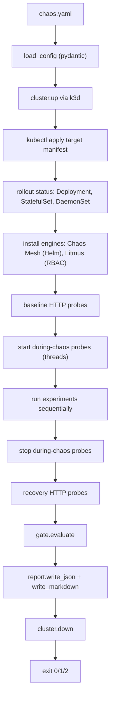

# Architecture

`chaos-ci-runner` is a thin Python orchestrator over existing CNCF tools.
The design goal is "smallest possible code surface that still answers a
real question." Everything heavy (cluster, chaos primitives, Helm
releases) is delegated.

## Components

| Module | Responsibility |
|---|---|
| `chaos_ci_runner.config` | pydantic v2 schema for `chaos.yaml`. |
| `chaos_ci_runner.cluster` | k3d cluster lifecycle (`up` / `down`). |
| `chaos_ci_runner.shell` | one place that calls subprocess (kubectl, helm, k3d). |
| `chaos_ci_runner.engines.base` | `ChaosEngine` protocol + kubectl/helm helpers. |
| `chaos_ci_runner.engines.chaos_mesh` | Helm install + apply Chaos Mesh CRDs. |
| `chaos_ci_runner.engines.litmus` | Run LitmusChaos experiments as Kubernetes Jobs (no full operator). |
| `chaos_ci_runner.probes` | HTTP and PromQL probes for baseline / during / recovery. HTTP p99 uses successful samples only. |
| `chaos_ci_runner.steady_state` | Compares recovery with the baseline from the same run. |
| `chaos_ci_runner.observability` | Optional Prometheus + kube-state-metrics Helm install. |
| `chaos_ci_runner.gate` | Experiment pass rate, probe SLO breaches, and steady-state return. |
| `chaos_ci_runner.score` | Composite 0-100 resilience score. |
| `chaos_ci_runner.regression` | Score drop versus a previous report, plus the experiment or probe that moved. |
| `chaos_ci_runner.report` | Render `report.json` and `report.md`. |
| `chaos_ci_runner.cli` | typer entry point: `run`, `plan`, `validate`, `schema`, `doctor`, `regression`, `version`. |

## Run flow



## Engines

Both engines implement the same `ChaosEngine` Protocol:

```python
class ChaosEngine(Protocol):
    name: str
    def install(self, cluster: Cluster) -> None: ...
    def run_experiment(self, cluster: Cluster, exp: ExperimentSpec) -> ExperimentResult: ...
    def cleanup(self, cluster: Cluster) -> None: ...
```

### Chaos Mesh

`install` runs `helm upgrade --install` with `--repo` pointed at the
Chaos Mesh chart repository, so CI does not refresh every cached Helm
repo first. The k3s flags that point the chaos daemon at containerd are
pre-set so it just works on k3d. `--create-namespace` creates
`chaos-mesh`.

`run_experiment` wraps the user's `spec` in the right CRD
(`PodChaos` by default; override with `kind:`), applies it, and
watches until the experiment stops. `Stop`, `AllRecovered`, a pause
after injection, or holding for the configured duration is success.
A pause before injection, or no injection within 60 seconds, is a
failure. The CRD is deleted afterwards.

### LitmusChaos

We deliberately do not install the Litmus operator or portal. v1 only
needs a namespace and a permissive ClusterRole bound to a service
account. `run_experiment` renders a single `batch/v1.Job` that runs
`litmuschaos/go-runner -name <experiment>` with the same env vars the
operator would inject, then watches the Job to completion.

This is enough for most pod-level experiments in the
[ChaosHub](https://hub.litmuschaos.io/) catalog. If you ever need the
full operator workflow, the engine adapter is the only thing that
changes; everything else (probes, gate, report) is unaffected.

## Probes

`HttpProbeSpec` is intentionally minimal in v1: a URL, success rate,
p99 latency, duration, interval, timeout. Probes run in three windows:

- `baseline` - synchronous, before chaos starts.
- `during` - in a background thread, started just before experiments and
  stopped right after.
- `recovery` - synchronous, after chaos ends, to verify steady state
  returns.

HTTP p99 sorts successful samples and indexes at `0.99 * (n - 1)`.
Failed samples stay in the success rate. PromQL probes are already
in the same three windows. A during-window snapshot is what the gate
scores, so a request still in flight after the probe stops cannot
change the result.

## Gate

Three failure modes:

1. **Experiment pass rate** below `gate.min_pass_rate_pct` is a fail.
   A skipped experiment, when halt-on-loss is enabled, does not count
   as a success.
2. If `gate.fail_on_probe_breach=true`, any probe window with a success
   rate below its SLO, an HTTP p99 above its SLO, or zero samples is a
   fail. A PromQL query must return exactly one series.
3. If `gate.require_steady_state_return=true` (the default), recovery
   that is more than 10 success points below this run's baseline, or
   an HTTP p99 at least 100ms and 50% slower, is a fail.

`GateOutcome` is structured: `passed`, `pass_rate_pct`, list of
`ProbeBreach` records, and human-readable reasons. The CLI exit code
mirrors this directly.

## Why not a Go binary?

Considered. Python wins for v1 because:

- The heavy lifting is shelling out to `k3d`, `kubectl`, `helm` - languages don't matter much there.
- The AIOps / MLOps phases (Prophet, scikit-learn, Evidently) live in Python.
- Smaller code volume to read and learn from.

A Go reimplementation is on the table if/when the orchestrator outgrows
subprocess wrapping.
